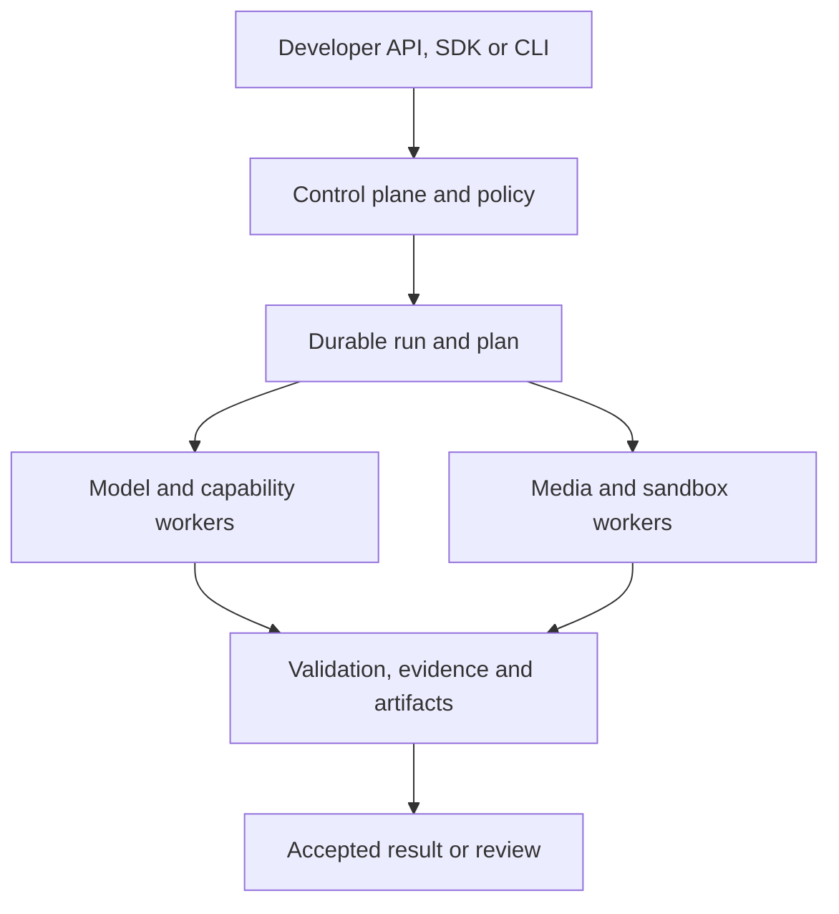

# Hawser — Complete Feature Blueprint

Feature-first product definition · 18 October 2026 · Version 1.0

This document describes the complete Hawser product by capability rather than by delivery phase. It defines what developers can build with Hawser, what the runtime is responsible for, what is included in the open-source edition, and what the managed service adds.

## 1. Product definition

Hawser is an open-source, self-hostable runtime for building reliable multimodal AI workflows.

A developer gives Hawser:

- One or more documents, images, audio files, videos, text blocks or JSON objects
- A goal or instruction
- An optional output schema
- A skill or set of permitted tools
- An execution policy covering models, cost, privacy, retries and review

Hawser plans and executes the work, selects approved models and tools, validates the result, performs bounded repairs, and returns:

- Structured data or generated artifacts
- Source evidence for important claims and extracted fields
- Validation results and review status
- Model, tool, token, latency and cost usage
- A reproducible execution history

The concise product promise is:

> Build verifiable multimodal AI workflows using your choice of models, tools and infrastructure.

Hawser is not a foundation model. It is the operational layer around models: planning, context, tools, execution, validation, evidence, repair, review, policy and observability.

## 2. Core developer experience

The primary developer workflow should be small and understandable:

```python
result = hawser.run(
    instruction="Compare this invoice with this purchase order",
    inputs=["invoice.pdf", "purchase-order.pdf"],
    output_schema=ReconciliationResult,
    policy={
        "max_cost": 0.25,
        "repair_attempts": 1,
        "review_on_failure": True,
    },
)
```

The response should contain:

```json
{
  "status": "accepted",
  "result": {},
  "evidence": [],
  "validation": {},
  "artifacts": [],
  "usage": {},
  "trace_id": "run_..."
}
```

The developer must be able to move from installation to a successful example in under ten minutes. A recorded example should run without a provider key; a live example may require the developer's provider key or local model.

## 3. Execution modes

Hawser provides three execution modes through the same API and result contract.

| Mode | Behaviour | Best use |
| --- | --- | --- |
| Direct | Calls a selected model or tool without agent planning | Simple questions and baseline comparison |
| Workflow | Executes developer-defined deterministic steps and branches | Stable production processes |
| Agent | Plans and selects permitted tools dynamically within policy limits | Variable or complex multimodal tasks |

The caller can explicitly select a mode or allow a skill to define it. Hawser must never use agentic execution where a deterministic operation is sufficient.

The evaluation system can compare all three modes on the same dataset. This demonstrates whether orchestration provides enough quality improvement to justify its additional latency and cost.

## 4. Inputs and ingestion

### 4.1 Supported inputs

The full product accepts:

- Plain text and Markdown
- JSON and structured records
- PDF documents
- Office documents through controlled conversion
- JPEG, PNG, WebP and other admitted image formats
- Audio in admitted codecs and containers
- Video in admitted codecs and containers
- Multiple related files in one run
- Stored Hawser artifact references
- Uploaded files and authenticated object-storage references

Public URL ingestion is optional and disabled by default because it introduces server-side request forgery, network-policy and reproducibility risks.

### 4.2 Admission and inspection

Before model execution, Hawser:

- Validates type, size and declared media format
- Computes a tenant-scoped content hash
- Detects corrupt, encrypted or unsupported files
- Probes page count, image dimensions, codecs, duration and estimated decode size
- Applies configurable byte, page, pixel, frame and duration limits
- Stores an immutable original and input manifest
- Estimates feasible execution classes and approximate cost

Malformed or oversized media produces a precise admission error instead of entering the agent runtime.

### 4.3 Normalised asset representation

All inputs are represented as versioned assets. An asset records:

- Media type and metadata
- Original and derived artifact identifiers
- Page, region, segment, frame or time indexes
- Coordinate and time transformations
- Content hashes
- Parent-child lineage
- Tenant, retention and access policy

Binary content moves through artifact storage. Workflows and RPC messages carry small typed metadata and authorised artifact references.

## 5. Document intelligence

Document capabilities include:

- Native text extraction
- Page rendering
- OCR
- Layout analysis
- Reading-order reconstruction
- Table detection and extraction
- Form and key-value recognition
- Document classification
- Multi-document grouping
- Schema-guided extraction
- Page and region grounding
- Document comparison
- Line-item matching
- Deterministic arithmetic and totals verification
- Redaction and annotation
- Splitting and merging
- Language detection
- Best-effort handling of unseen layouts

Hawser publishes three support levels:

| Level | Meaning |
| --- | --- |
| Accepted format | Hawser can open, normalise and inspect the document |
| Best-effort extraction | Hawser attempts the requested schema and may return unknown or review-required fields |
| Verified skill | The workflow has passed a published evaluation for a defined document class |

Broad format acceptance never implies uniform extraction accuracy.

## 6. Image intelligence

Image features include:

- Captioning and visual question answering
- Object detection
- Visual grounding
- Segmentation
- Keypoint or point localisation
- OCR and scene-text extraction
- UI and screenshot parsing
- Classification and tagging
- Similarity and embedding operations
- Cropping, rotation, deskewing and resizing
- Redaction, annotation and overlays
- Upscaling and approved image-generation/editing adapters

All coordinate-producing operations retain transformations so evidence can be mapped back to the original image.

## 7. Audio intelligence

Audio features include:

- Format probing and controlled transcoding
- Speech-to-text
- Speaker diarisation
- Language identification
- Time-aligned transcripts
- Segment extraction
- Audio classification and tagging
- Question answering over indexed transcripts
- Evidence linked to start and end timestamps

Long audio is chunked, checkpointed and processed under explicit duration, compute and cost limits.

## 8. Video intelligence

Video features include:

- Format probing and controlled transcoding
- Audio-track extraction and transcription
- Scene and shot detection
- Configurable frame sampling
- Temporal captioning
- Object detection and tracking adapters
- OCR from frames
- Query-directed retrieval of relevant scenes
- Question answering over video and transcript indexes
- Timestamped evidence
- Video clipping, annotation and redaction
- Approved video-generation/editing adapters

Hawser does not place an entire long video into model context. It builds a compact temporal index and retrieves relevant frames, scenes and transcript segments.

## 9. Model gateway

The model gateway provides a common contract across hosted and self-hosted models.

Every model adapter declares:

- Provider and model identifier
- Supported modalities
- Context and output limits
- Structured-output capability
- Tool-calling capability
- Streaming support
- Region and data-handling attributes
- Pricing metadata
- Timeout and retry behaviour
- Known capability constraints

Gateway features include:

- Bring-your-own provider credentials
- Hosted-provider adapters
- Local and open-weight model adapters
- Capability-aware selection
- Explicit model pinning
- Policy-controlled fallback
- Normalised requests, responses, errors and usage
- Token and cost accounting
- Rate-limit handling
- Version and configuration snapshots
- Compatibility tests for third-party adapters

Fallback must never silently violate privacy, region, quality or cost policy.

## 10. Planning and orchestration

### 10.1 Typed plans

Agent mode compiles a goal into a typed execution plan. A plan can contain:

- Sequential steps
- Conditional branches
- Bounded loops
- Parallel fan-out and aggregation
- Tool and model calls
- Deterministic calculations
- Artifact creation
- Validation gates
- Human review checkpoints
- Bounded repair paths
- Explicit success and failure exits

Plans are validated before execution. Unknown tools, missing permissions, excessive budgets and unsupported capabilities are rejected before work begins.

### 10.2 Durable runs

Runs support:

- Asynchronous execution
- Progress events
- Checkpointing
- Worker crash recovery
- Timeouts
- Cancellation
- Safe retries
- Idempotency
- Approval pauses
- Resume after review
- Duplicate-delivery protection

External side effects require stable action identifiers and reconciliation because retries cannot guarantee exactly-once behaviour outside Hawser.

### 10.3 Budget control

Policies can limit:

- Total cost per run
- Model and tool calls
- Tokens
- Pages and decoded pixels
- Audio/video duration and sampled frames
- Plan steps and loop iterations
- Parallel operations
- Repair attempts
- Sandbox executions
- Whole-job duration

The runtime reserves budget before parallel dispatch, settles actual usage and stops when further work would exceed policy.

## 11. Tool system

Tools are typed, versioned capabilities. Each ToolSpec declares:

- Name and version
- Input and output schemas
- Supported modalities
- Required permissions
- Side-effect classification
- Resource and time limits
- Cost estimate
- Retry classification
- Idempotency behaviour
- Runtime location

Tools return typed values, artifact references, evidence, usage and structured errors. They cannot grant themselves permissions or access unrestricted credentials.

Tool families include:

- Documents
- Images
- Audio
- Video
- Deterministic computation
- Search and retrieval
- Data conversion
- External APIs
- Artifact generation
- Human-review requests
- Sandboxed programs

The tool broker is the only path through which an agent invokes privileged operations.

## 12. Skills

A skill is a versioned, reusable workflow bundle. It can include:

- Human-readable name and description
- Accepted input types
- Output schema
- Execution mode
- Prompt and planning guidance
- Permitted models and tools
- Deterministic workflow steps
- Validators
- Evidence requirements
- Budgets and limits
- Review policy
- Evaluation dataset references
- Compatibility requirements
- Example inputs and expected outputs

Example skill definition:

```yaml
name: invoice-po-reconciliation
version: 1.0.0
mode: workflow
inputs:
  invoice: document
  purchase_order: document
output_schema: ReconciliationResult
tools:
  - document.inspect
  - document.extract
  - document.ground
  - compute.reconcile
validators:
  - required_fields
  - totals_match
  - evidence_present
policy:
  repair_attempts: 1
  review_on_failure: true
```

Skills can be installed locally, pinned, exported, tested and upgraded. Permission changes must be visible during installation or upgrade.

## 13. Context and working state

Hawser controls what the model sees. It does not repeatedly place every input and intermediate artifact into model context.

The context manager provides:

- Page and region indexes for documents
- Scale and region indexes for images
- Timed transcript segments for audio
- Scene, frame and transcript indexes for video
- Compact plan and run state
- Summaries of prior steps
- Relevant validation failures
- Tool schemas and current permissions
- Retrieval of the smallest useful evidence window

Context selection is recorded so results can be inspected and reproduced.

## 14. Structured outputs

Hawser supports:

- JSON Schema and Pydantic-compatible output contracts
- Required, optional and nullable fields
- Nested objects and arrays
- Enumerations and constrained values
- Partial results
- Explicit unknown values
- Field-level evidence
- Validation issues
- Review state
- Generated artifact references

A syntactically valid JSON response is not automatically an accepted result. Acceptance is determined by validation and policy.

## 15. Evidence and provenance

Evidence is a native product object, not a textual explanation added afterward.

Evidence types include:

- Document page and bounding region
- Image bounding box, mask or point
- Audio start and end time
- Video timestamp, frame, scene or track
- Source text span
- Deterministic calculation inputs
- Parent artifact and transformation lineage

Every evidence reference records the original asset, coordinate or time system, derived transformations, producing tool and relevant model configuration.

Example field response:

```json
{
  "value": "INV-1042",
  "evidence": {
    "asset_id": "asset_invoice",
    "page": 1,
    "bounding_box": [120, 80, 260, 112],
    "text": "Invoice No: INV-1042"
  },
  "validation": {
    "status": "passed",
    "rules": ["invoice_number_format"]
  }
}
```

## 16. Validation and repair

Validators can be:

- Schema validators
- Required-field checks
- Type and format checks
- Arithmetic checks
- Cross-field consistency rules
- Cross-document reconciliation rules
- Evidence-presence and evidence-consistency checks
- Business-rule plugins
- Safety and policy checks
- Model-based judges used only where deterministic checks are insufficient

Each issue has a stable rule identifier, severity, affected field, evidence and repairability classification.

For repairable failures, Hawser can:

- Retrieve a more relevant crop or page
- Re-run OCR on a region
- Select a different approved model
- Ask for a missing field only
- Recalculate deterministic values
- Re-execute an approved step
- Request human review

Repairs are bounded by attempts, time and cost. Equivalent attempts that produce no new evidence are stopped. Hawser can abstain instead of manufacturing a value.

## 17. Review and approval

Terminal run states are:

- `accepted`
- `needs_review`
- `rejected`
- `failed`
- `cancelled`

The review system provides:

- Side-by-side source and extracted result
- Highlighted page, region or timestamp evidence
- Validation issues
- Editable field values
- Reviewer comments
- Approval and rejection
- Concurrent-edit protection
- Immutable machine output
- Separate reviewed revisions
- Reviewer identity and timestamp
- Export of original and reviewed results

Side-effecting tools can require approval before execution. Approval records exactly what action, payload and destination were authorised.

## 18. Generated-code sandbox

Hawser can optionally allow an agent to generate a program using approved SDK primitives. Code mode is disabled unless a configured sandbox passes its security requirements.

Sandbox requirements include:

- Strong process or microVM isolation
- No host credentials
- No shared writable host mounts
- Denied network access by default
- Explicit egress allowlists
- CPU, memory, process, time and output limits
- Read-only approved tool SDK
- Ephemeral execution environment
- Captured stdout, stderr and exit status
- Complete artifact and action audit
- Escape and exfiltration testing

Generated code cannot bypass the tool broker, policy engine, artifact service or approval system.

## 19. Artifacts and lineage

Hawser stores immutable inputs and derived artifacts such as:

- Rendered pages
- Crops
- Masks
- Annotations
- Transcripts
- Extracted tables
- Generated reports
- Redacted media
- Audio/video clips
- Generated images or videos
- Sandbox outputs

Every artifact records its creator, parents, transformations, content hash, media metadata, tenant, retention policy and access rules.

Signed URLs or an authorised artifact proxy provide time-limited access. Tenant isolation applies to metadata and object access.

## 20. Tracing, replay and debugging

Every run exposes:

- Pinned skill, model, tool and policy versions
- Generated or selected plan
- Step start and completion events
- Tool inputs and outputs with configured redaction
- Model request metadata
- Context selections
- Tokens, latency and cost
- Validation failures
- Repair decisions
- Review events
- Final status and output revision

Recorded tool results can be used for deterministic replay and debugging without repeating every paid model call. Re-execution against live models is identified separately because non-deterministic outputs may change.

## 21. Evaluation system

Evaluation is a developer-facing feature.

The CLI and SDK support:

```bash
hawser init
hawser run
hawser eval
hawser compare
hawser inspect
```

Evaluation capabilities include:

- Versioned datasets
- Expected structured outputs
- Field-level and document-level scoring
- Evidence-quality checks
- Deterministic validator results
- Review-rate measurement
- Cost and latency measurement
- Direct-versus-workflow-versus-agent comparison
- Model and provider comparison
- Skill-version regression testing
- Failure clustering
- Reproducible configuration snapshots
- CI quality gates

Live-model evaluations run under explicit budgets. Recorded fixtures make ordinary unit and integration tests deterministic.

## 22. APIs and integrations

Hawser provides:

- REST/OpenAPI API
- Server-sent progress events
- Signed completion webhooks
- Python SDK
- TypeScript SDK
- Go command-line interface
- MCP server exposing admitted Hawser capabilities
- MCP client support for approved external tools
- Provider, tool, validator, storage and sandbox extension interfaces

Core API resources include:

- Assets
- Runs
- Steps and events
- Skills and versions
- Models and tools
- Schemas
- Results and revisions
- Evidence
- Artifacts
- Evaluations and datasets
- Reviews and approvals
- Usage and budgets

## 23. Web application

The web interface includes:

- Multimodal playground
- File and asset browser
- Schema editor
- Skill inspector
- Plan visualisation
- Live run progress
- Step and trace inspector
- Evidence viewer
- Review workspace
- Evaluation comparison dashboard
- Model/tool registry
- Usage and cost view
- Policy configuration
- Administration for managed deployments

The interface should expose runtime behaviour rather than hide it behind a chat window.

## 24. Security and privacy

Security controls include:

- Tenant-scoped authorisation
- Encryption in transit and at rest
- Secret isolation and rotation
- Bring-your-own provider credentials
- Provider and region allowlists
- Network-egress policy
- Retention and deletion rules
- Redacted logs and telemetry
- Signed webhook verification
- Rate limits and quotas
- Malware and decompression-bomb protections
- Prompt-injection-resistant tool permissions
- Side-effect approval
- Immutable audit events
- Dependency, image and SBOM scanning
- Security disclosure and revocation processes

Media, OCR text and tool results are untrusted data. They cannot change system policy or grant capabilities.

## 25. Storage and runtime services

The reference architecture uses:

| Concern | Selected approach |
| --- | --- |
| Public API and stable platform services | Go control plane |
| AI, model and media capabilities | Python workers |
| Public data contracts | REST/OpenAPI and JSON Schema |
| Internal cross-language contracts | Protobuf/gRPC |
| Durable execution | Temporal |
| Product metadata | PostgreSQL |
| Artifact storage | S3-compatible storage; local adapter for development |
| Web interface | React and TypeScript |
| Telemetry | OpenTelemetry |
| Local deployment | Docker Compose |
| Production deployment | Containers and an optional Helm chart |
| Managed code isolation | Hardened sandbox adapter, with microVM-class isolation as a target |

The architecture keeps the reliable control plane separate from rapidly changing AI and media dependencies. A simpler local runner may support development, but Hawser has only one production durability model.



## 26. Self-hosting and deployment

The open-source deployment includes:

- Versioned container images
- Docker Compose quickstart
- Local filesystem and S3-compatible artifact options
- PostgreSQL migrations
- Health and readiness endpoints
- Environment and secret configuration
- Sample provider setup
- Sample datasets and recorded fixtures
- Upgrade, backup, restore and uninstall documentation
- Optional production Helm chart
- No mandatory Hawser Cloud account
- Opt-in telemetry only

An operator can execute a useful workflow with their own provider key or local model.

## 27. Multitenancy and managed operations

Managed Hawser adds:

- Organisations, projects and environments
- Users, service accounts and API keys
- Role-based access controls
- Quotas and rate limits
- Usage reservations and settlement
- Subscription and execution billing
- Team review queues
- Managed provider credentials
- Dedicated and private deployments
- Autoscaling worker pools
- Availability and support commitments
- Retention administration
- Operational dashboards and incident tooling
- Enterprise identity and audit exports

The managed service uses the open runtime; it does not replace the functional core with a proprietary engine.

## 28. Open-source and commercial boundary

| Open-source Hawser | Hawser Cloud and enterprise services |
| --- | --- |
| Execution runtime and planner | Operated and autoscaled execution |
| Model and tool adapter contracts | Hosted model access and managed credentials |
| Document and multimodal workers | Managed resource pools |
| Skills and validators | Private skill management and verified workflow services |
| Evidence, artifacts and traces | Team-scale review and retention administration |
| Evaluation CLI and SDK | Evaluation dashboards and scheduled regression runs |
| REST API, CLI and Python SDK | Accounts, subscriptions and billing |
| Basic review UI | Enterprise review controls |
| Docker Compose self-hosting | SLA, support and dedicated deployments |
| Portable sandbox adapter | Hardened managed sandbox operation |

The open-source edition must remain useful without the commercial service. Commercial value comes from reliable operation, scale, security administration, support and workflow expertise.

## 29. Reference workflow

The public reference workflow is invoice-to-purchase-order reconciliation.

It demonstrates:

- Multi-document classification
- Dense table extraction
- Schema-guided structured output
- Line-item alignment
- Deterministic arithmetic
- Cross-document validation
- Page and region evidence
- Exceptions and `needs_review`
- Cost and execution traces
- Human correction

The workflow produces extracted invoice and purchase-order records, matched line items, discrepancies, validation issues, evidence and a review state. It does not write into an ERP unless a separately authorised connector action is configured.

This is an adoption example, not a limitation on Hawser's horizontal runtime.

## 30. Product quality requirements

Hawser is considered usable when:

- A new developer completes the live quickstart in under ten minutes
- A recorded example works without paid credentials
- The same skill can run against at least two model providers
- Every important extracted field can carry inspectable evidence
- Validation failures cannot be silently labelled accepted
- Repair attempts are bounded and visible
- A worker crash resumes at a safe boundary
- Replayed events do not duplicate published results, actions or customer charges
- Tenant boundaries cover runs, artifacts, events and signed access
- Cost and usage reconcile at the run and step levels
- A third party can implement an adapter using public contracts and compatibility tests
- The reference workflow publishes reproducible quality, cost, latency and review metrics
- A self-hosted operator does not require Hawser Cloud

## 31. Explicit non-goals and boundaries

Hawser does not promise:

- Perfect accuracy for every document or media type
- A proprietary foundation model
- Automatic replacement of human review for unevaluated workflows
- Unrestricted execution of generated code
- Silent access to external systems
- Exactly-once behaviour from external providers
- A no-code solution for every business process
- Uniform quality across languages, layouts and providers

The model can recommend actions, but policy, permissions, budgets, approvals and acceptance are enforced by the runtime.

## 32. Repository shape

Hawser begins as a monorepo:

```text
api/proto               internal cross-language contracts
api/openapi             public REST contract and generated schemas
control/cmd             Go API server and CLI entry points
control/internal        policy, tenancy, usage and artifact metadata
control/workflows       durable workflows
python/hawser_sdk       Python client and extension API
python/workers          planning, providers and capability activities
python/media            document, image, audio and video primitives
python/evals            evaluation engine and metrics
sandbox                 broker and isolation adapters
skills                  versioned workflow bundles
mcp                     inbound and outbound MCP adapters
web                     playground, inspector and review UI
deploy/compose          local self-hosting
deploy/helm             production deployment option
examples                reference workflows
docs                    architecture, security and operator guides
```

Additional repositories should be created only when independent release cycles or ownership require them.

## 33. Complete product outcome

When Hawser is complete, a developer can:

1. Install Hawser locally or use Hawser Cloud.
2. Connect hosted or local models.
3. Define a typed multimodal skill.
4. Give it documents, images, audio, video or mixed inputs.
5. Choose direct, deterministic workflow or bounded agent execution.
6. Permit only approved models and tools.
7. Receive structured results and generated artifacts with evidence.
8. Validate, repair, abstain or route uncertain results to review.
9. Inspect and replay every important execution decision.
10. Evaluate changes against versioned datasets.
11. Deploy the same workflow in a self-hosted or managed environment.
12. Operate it with budgets, security, auditability and clear failure behaviour.

That is the complete Hawser product: not merely an OCR API, model gateway, agent framework or workflow engine, but the reliable runtime that connects those capabilities into verifiable multimodal applications.
